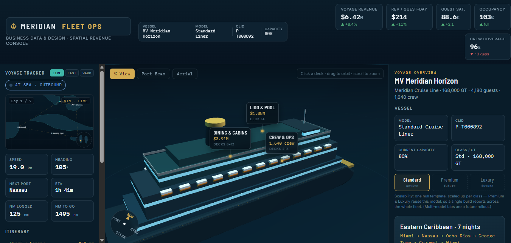

# Meridian Fleet Ops

An interactive 3D spatial revenue console for a cruise line — click any deck of the ship to drill from vessel-level KPIs down to venue, cabin, and crew analytics, while a simulated voyage tracks real Caribbean port coordinates in real time.

**Live demo:** https://tbportfolio-dotcom.github.io/meridian-fleet-ops/

> Built as a portfolio piece pairing data analytics with 3D, spatial data visualization. All figures are synthetic demo data.

## What it does
- **Spatial drill-down** — a 3D ship where each deck binds to operational data; click a deck to inspect its venues, cabins, or crew.
- **Voyage tracker** — a simulated 7-night Eastern Caribbean itinerary (Miami → Nassau → Ocho Rios → George Town → Cozumel → Miami) on real port coordinates, with haversine distances driving speed, heading, ETA, and nautical miles logged.
- **Revenue analytics** — per-deck KPIs (voyage revenue, revenue/guest-day, occupancy, guest satisfaction, crew coverage) and per-venue revenue breakdowns.
- **Automated insights** — each deck surfaces a templated insight + recommendation, designed to plug into a live LLM against current metrics in production.

## How it works

**Voyage simulation.** Each port carries real latitude/longitude. The [haversine formula](https://en.wikipedia.org/wiki/Haversine_formula) computes leg distances in nautical miles, and the full loop's real-time duration is derived from total distance ÷ cruising speed (19 kn). The sim interpolates the ship's position along the current leg, then back-calculates everything on the dashboard — speed, heading (via a bearing calculation between coordinates), next port, ETA, and nautical miles logged vs. remaining. `LIVE / FAST / WARP` just scale the sim clock.

**Deck-to-data binding.** A single data model defines each deck and its zones, where every zone stores a normalized footprint (`x`, `z`) on the deck. That one object drives *two* things at once: the 3D zone meshes placed on the ship, and the right-panel analytics (KPIs, charts, zone list, and the insight card). So the spatial model and the numbers can never drift apart — they read from the same source.

**Interaction.** Clicking a deck (in the sidebar or directly on the 3D model) renders that deck's analytics; clicking a zone isolates and highlights its floating label on the ship. The camera uses orbit controls (azimuth / polar / distance) with preset ¾, Port Beam, and Aerial views.

**Charts.** All visuals — bar, stacked, and grouped — are hand-built as inline SVG from the data, no charting library.

## Tech stack
- **Three.js** (r128) — 3D ship model and scene
- **WebGL** — rendering
- **Vanilla JavaScript, HTML, CSS** — UI, hand-built SVG charts, and the voyage simulation
- **GitHub Pages** — hosting

## Run locally
Clone the repo and open `index.html` in any modern browser — no build step, no dependencies.
